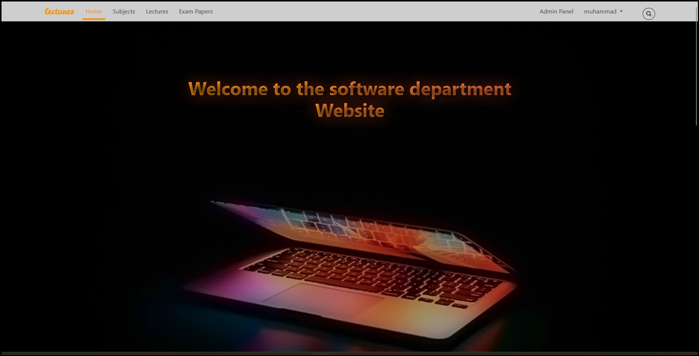

## What I built

Created a digital learning management system for university departments to organize lectures, assignments, and student progress tracking.

Developed features for lecture scheduling, resource sharing, assignment submission, grading systems, and academic performance analytics.

Implemented secure file access and organized academic record management.

## Screenshot

[Back to Projects](../)
