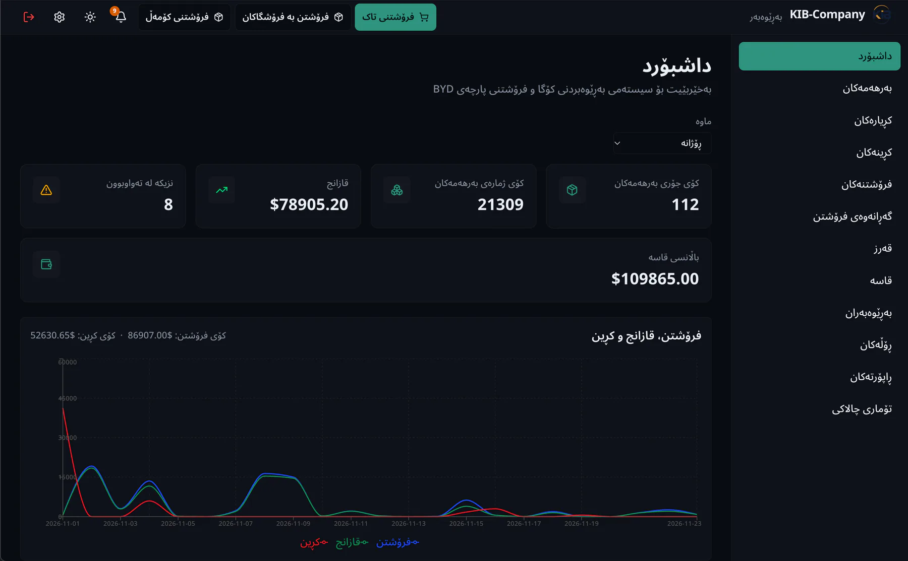

## What I built

Built an inventory and sales management system for KIB Company, a BYD auto-parts business, covering the product catalog with vehicle compatibility, purchases, customers, and a cash safe ledger.

Implemented FIFO batch costing so every sale draws from the oldest stock and profit is calculated per batch, alongside sequential invoice numbers, partial sale returns, partial payments, and debt collection.

Delivered three point-of-sale modes (retail, bulk, and store sales), a dashboard with sales, profit, and purchase charts, low-stock alerts, a scheduled daily Telegram report, PDF and Excel exports, role-based access, activity audit logs, and a fully RTL Kurdish interface.

## Screenshot

[Back to Projects](../)
