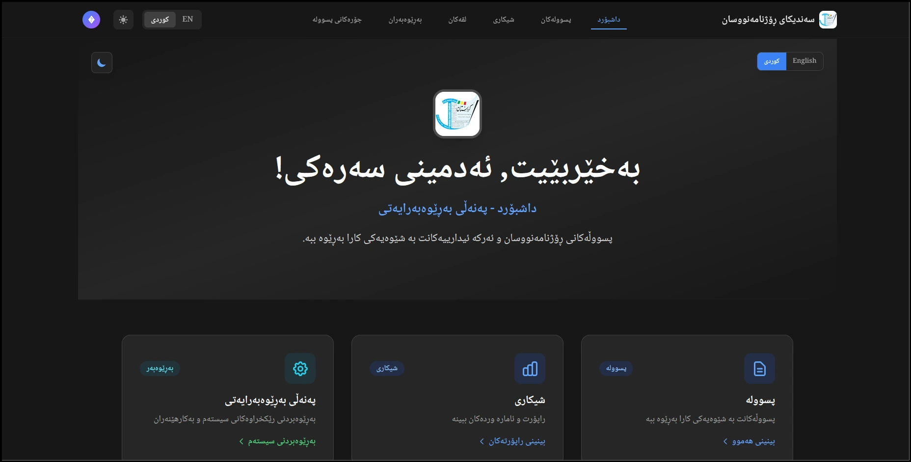

## What I built

Designed and developed a comprehensive analytics platform for the Kurdistan Journalists Syndicate to track journalist activities, media coverage, and industry trends.

Created data visualization dashboards with real-time reporting capabilities for monitoring press freedom, journalist safety, and media landscape analysis.

Integrated secure member management, content categorization, and statistical reporting tools for strategic decision-making and advocacy purposes.

## Screenshot

[Back to Projects](../)
