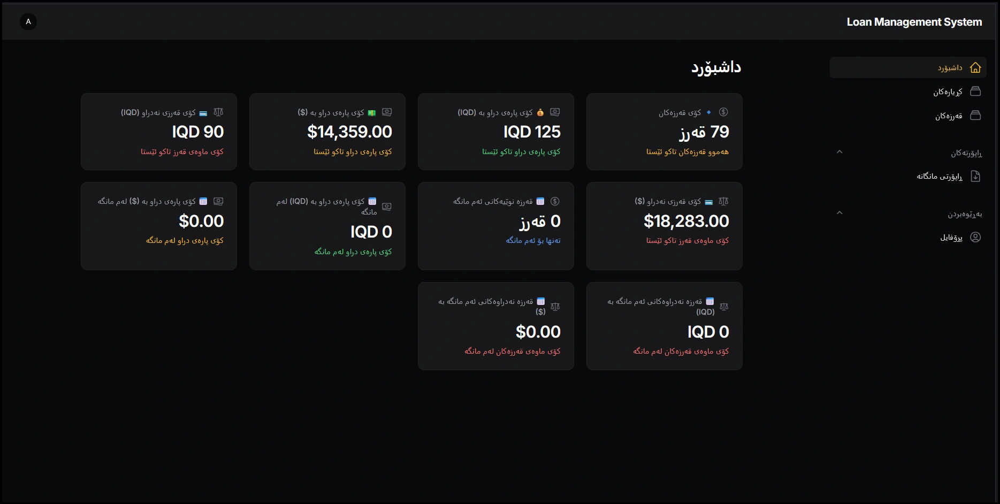

## What I built

Developed a comprehensive loan management platform for financial institutions with automated loan processing, approval workflows, and risk assessment.

Created secure customer-facing and admin workflows for loan applications, document uploads, payment tracking, and communication with loan officers.

Built administrative dashboards for loan portfolio management, performance analytics, regulatory compliance reporting, and customer relationship management.

## Screenshot

[Back to Projects](../)
