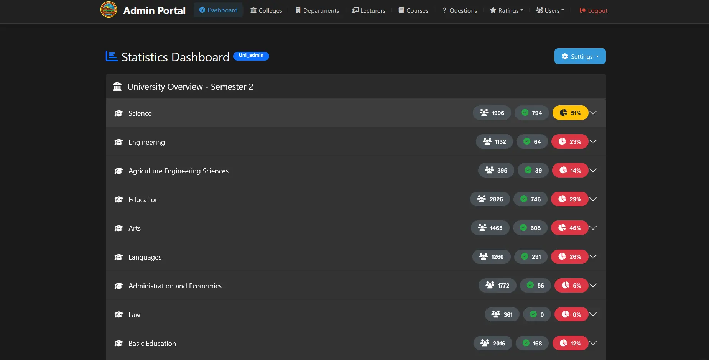

## What I built

Developed a comprehensive feedback management platform for Salahaddin University serving over 20,000 active users, including students, faculty, and administrators.

Built as a full-stack Laravel application with role-based access control, structured admin workflows, and advanced analytics for monitoring institutional feedback.

Implemented secure authentication, dashboard reporting, and maintainable interface flows to streamline feedback collection and administrative decision-making.

## Screenshot

[Back to Projects](../)
